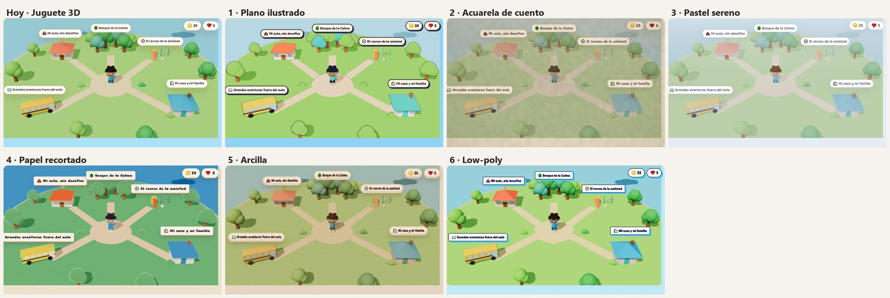
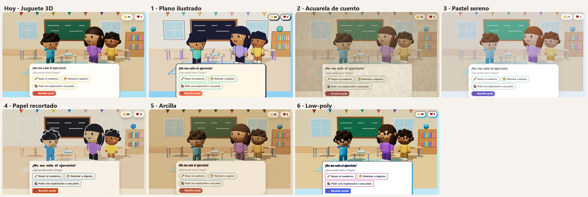
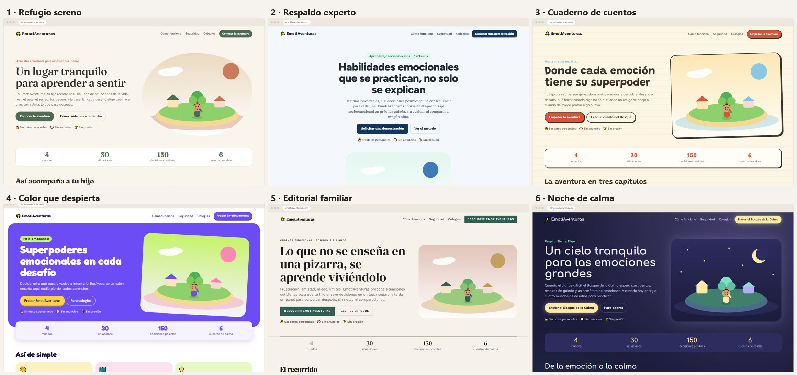
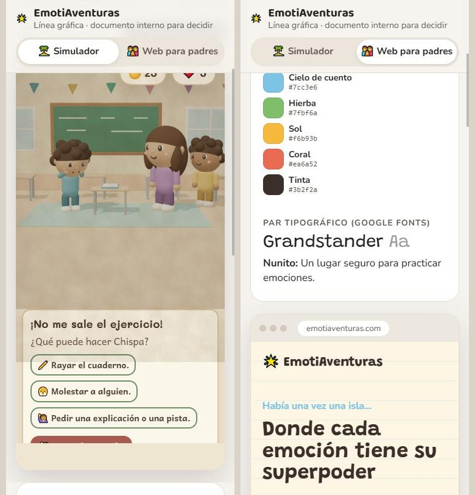

# Línea gráfica

Material para decidir el estilo del simulador y de la web oficial. Se ve en vivo en la ruta oculta **`/business`**: no la enlaza ningún botón, lleva `noindex` y se llega solo escribiendo la URL.

- **Simulador:** `/business#simulador/<estilo>/<escena>`. Estilos: `actual`, `plano`, `acuarela`, `pastel`, `papel`, `arcilla`, `lowpoly`. Escenas: `mapa`, `desafio`, `bosque`.
- **Web para padres:** `/business#web/<estilo>`. Estilos: `refugio`, `experto`, `cuaderno`, `color`, `editorial`, `noche`.
- **Benchmarking:** [benchmarking.md](benchmarking.md).

Los estilos del simulador re-visten la escena 3D real (materiales, luces y paleta) sin tocar sus componentes: el simulador de `/` no cambia. El código está en `src/features/business/`.

## Capturas (2026-11-09)

Simulador, mapa de mundos:

Simulador, desafío en el aula:

Web para padres:

Celular:

